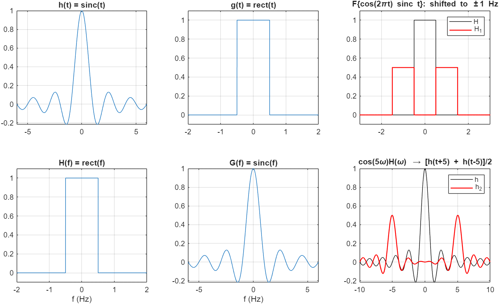
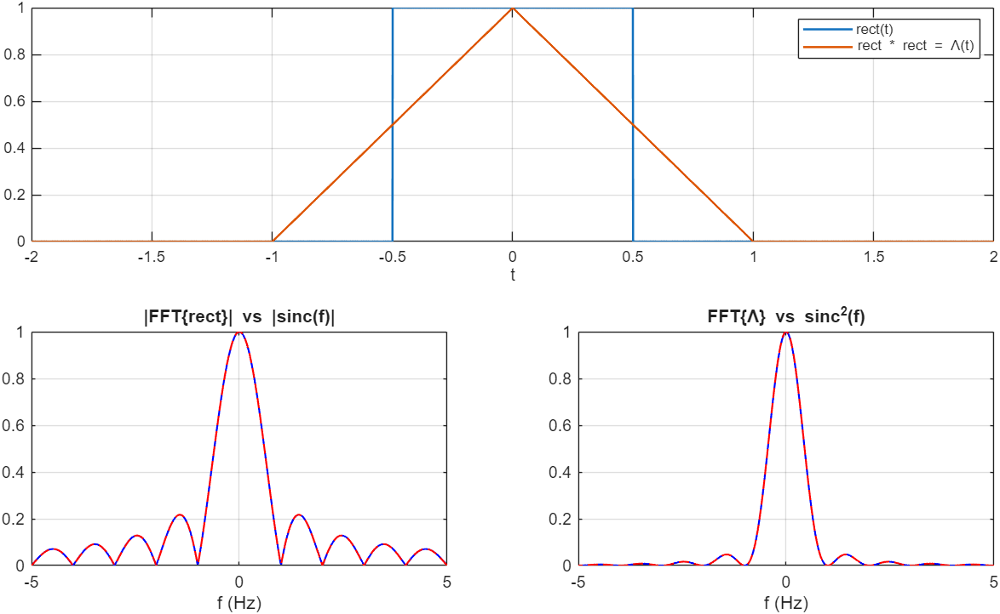
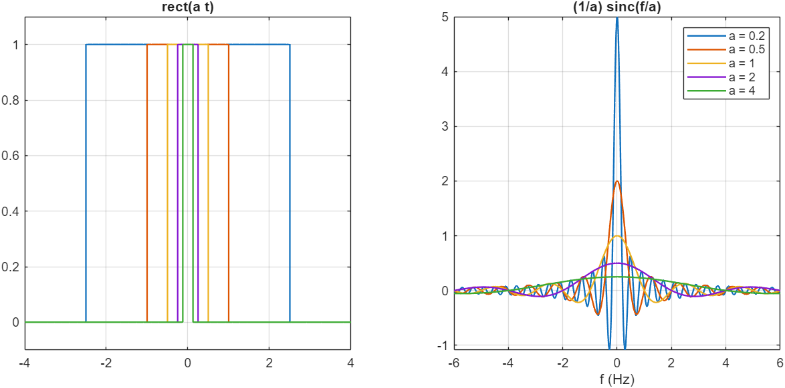
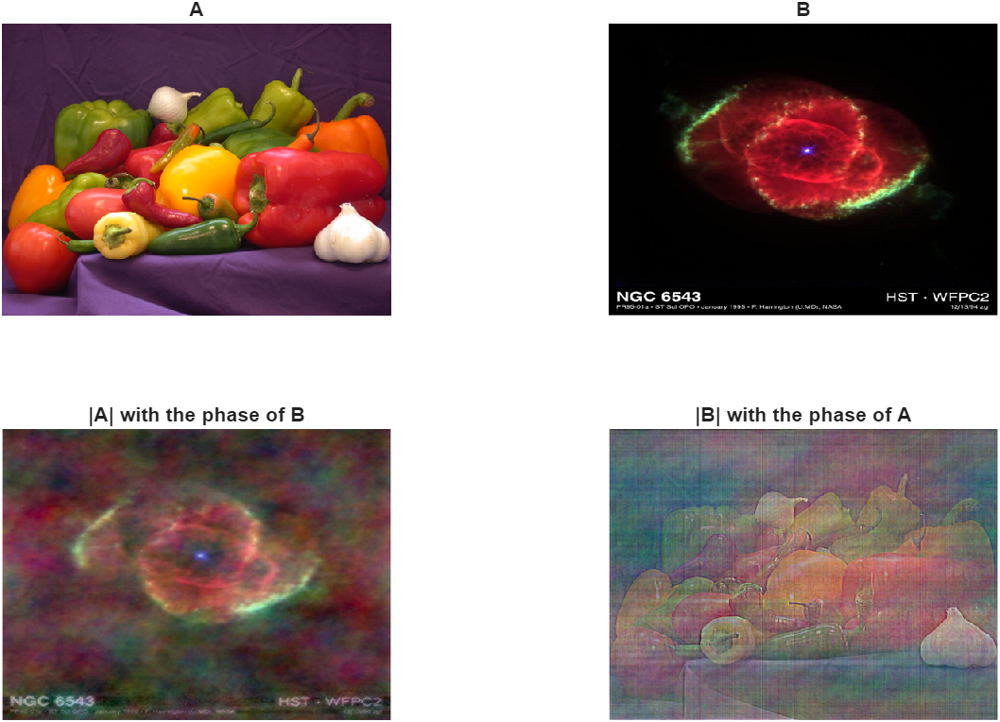
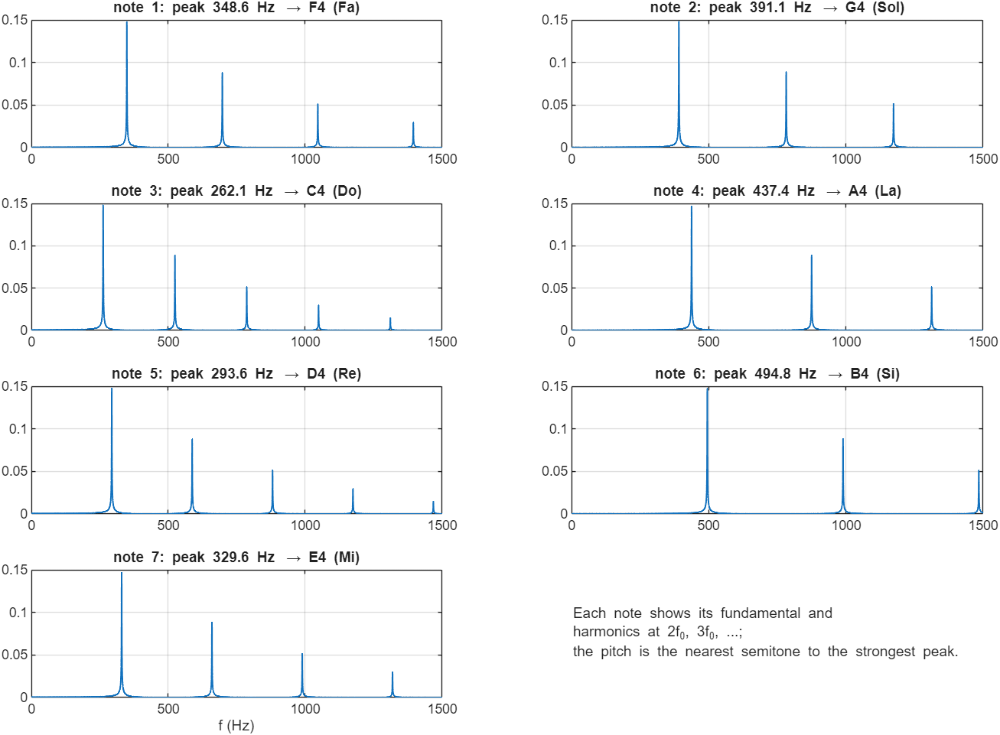

# Engineering Mathematics, TA Solutions for MATLAB Homework 2: The Fourier Transform

> **Context:** These are reference solutions I wrote as a **teaching assistant** for Engineering Mathematics at Amirkabir University of Technology. This repo is a cleaned-up and verified version of them.
>
> Run `main` in MATLAB (Symbolic Math and Image Processing toolboxes). Figures go to `results/`.

| Q | Topic | Verified result |
|---|---|---|
| 1 | Duality, modulation, and multiplication by cos 5ω | F{sinc} = rect(f), F{rect} = sinc(f). cos 2πt·sinc t moves to ±1 Hz at half height. cos(5ω)H(ω) ⇔ [h(t+5) + h(t−5)]/2, and the symbolic difference simplifies to **0** |
| 2 | Convolution theorem with the FFT | rect ∗ rect = Λ (peak 0.999). The scaled FFT matches sinc and sinc² to 10⁻³ |
| 3 | Time scaling of rect(at), a = 0.2 … 4 | F = (1/a) sinc(f/a): F(0) = 1/a and the first zero is at f = a for every a. Compress in time ⇔ expand in frequency |
| 4 | Swap FFT magnitude and phase of two colour images | The result looks like the **phase** donor: correlation 0.70 with it, 0.35 with the magnitude donor |
| 5 | Identify seven musical notes from their spectra | All seven correct: F G C A D B E (the same sequence as the original recordings) |

| Q1 | Q2 |
|---|---|
|  |  |

| Q3 | Q4 |
|---|---|
|  |  |

**Q5 method.**
- **Input.** Each note is a decaying fundamental plus four harmonics. One note is sampled at 48 kHz and the rest at 44.1 kHz, as in the original set.
- **Spectrum.** A zero-padded FFT, with the frequency axis built from each file's own sample rate.
- **Decision.** The pitch is the equal-tempered semitone nearest the strongest peak: round(12 log₂(f/f_ref)).

## Changes compared with the original solutions
- **Q1 axes.** H(ω) was left on the angular-frequency axis while G was converted to Hz (the conversion line was commented out), so the two spectra were drawn on different axes. Both now use f in Hz.
- **Q1 cosine filter.** The plot title said "cos(10πw)" but the code used cos(5ω). The two-echo result is now derived and checked symbolically.
- **Q2 resolution and scaling.** The convolution used only 40 samples. Both the convolution and the spectra were normalised by `n/2` instead of the sample spacing dt. The odd-length frequency axis was also half a bin off. The new version uses dt-scaled `conv` and FFT, zero padding, and overlays the analytic sinc and sinc².
- **Q4 reconstruction.** The images were rebuilt with `uint8(abs(ifft2(...)))`. Now `real(...)` is taken and rescaled, so the reconstructions are not clipped.
- **Q5 code.** It was seven copy-pasted blocks. They are now one loop with an automatic note decision.
- **Course media.** The course's photos (rose, peak) and note recordings are not redistributed. Q4 uses sample images that ship with MATLAB, and Q5 synthesises the notes.

**Sepehr Ebrahimi**, B.Sc. Electrical Engineering, Amirkabir University of Technology (2026)
